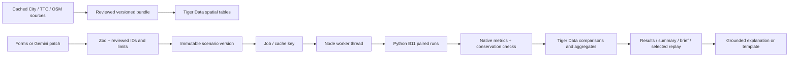

# Architecture

The Express API is in `backend/server`; the simulator remains the team's Python B11 engine. Rewriting it in TypeScript would duplicate the model. The frontend imports the frozen contracts and is owned by Lane D.

Gemini translates fields and explains stored comparisons; it does not compute results. `GEMINI_ENABLED=false` explicitly disables it while forms remain available. Startup validates the database URL, model, origins, key and timeout without echoing credentials.

`npm run pipeline --prefix backend/server -- --scenario demo --runs 20` follows the same submission, validation, worker, integrity and persistence path as HTTP. The two-phase template keeps housing constant across packages. Jobs pin the reviewed-data digest, simulation/adapter digest, orchestrator version and random configuration. New workers claim matching versions only. Each claim has a renewable lease, including during persistence.

Tagged claims are checked in PostgreSQL as well, using the connection's version fingerprint; this protects newer jobs from older teammates' unfiltered claim queries. The configured-simulation endpoints added in the pull remain available and now run their computation and validation in a worker thread. The owner's tick engine, bounded dwell and negative-time warm-up are retained; no second simulator is maintained.

Tiger Data holds immutable bundle snapshots plus spatial stops, links, developments and walking access; scenario versions; jobs; full native summaries and aggregates for every run; and a full passenger/event archive for one selected illustrative run. Other runs explicitly declare `summary-only` retention and include an initial-journey digest, rather than duplicating all replay archives. Native metric definitions remain authoritative.

Python source scripts read cached upstream files; serving a corridor or running a simulation never calls those upstream sites. Gemini and Tiger Data still require network access. There is no offline database fallback, as agreed by the team.

Railway builds `backend/server/Dockerfile` from the repository root and starts `node backend/server/dist/backend/server/src/index.js`. The scheduler launches automatically. `backend/server/db/queries.sql` contains the three judge-facing query examples. Performance claims require a measured workload; none is inferred from the schema alone.
